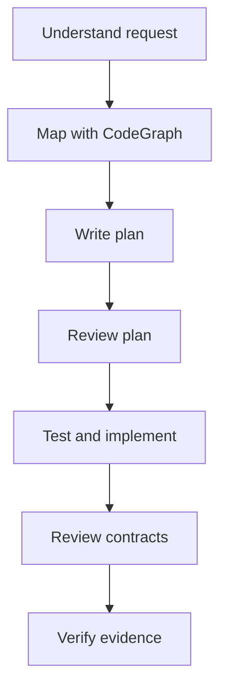

# FastAPI Agentic Boilerplate

A FastAPI starter with a working API example and an AI-assisted development
workflow. It gives developers a consistent backend structure, production-safe
defaults, automated verification, and clear instructions for coding agents.

Use it to start a service or as a reference when adding features to an existing
FastAPI codebase. Describe the outcome you want, and the harness guides the agent
through discovery, planning, implementation, review, and verification.

## What it does

- Runs a typed async FastAPI service backed by PostgreSQL and Alembic
- Demonstrates a complete create/read API flow with tests
- Keeps code organized as
  `routes -> views -> controllers -> helpers -> models/schemas`
- Provides liveness, database readiness, request IDs, JSON logs, and Prometheus
  metrics
- Uses a locked `uv` environment and a non-root production container
- Checks linting, formatting, types, tests, coverage, dependencies, secrets, and
  commit messages
- Gives coding agents scoped roles for mapping, plan review, contract review, and
  test selection
- Uses CodeGraph to understand relevant code paths before loading or editing broad
  parts of the repository
- Blocks common unsafe commands through a pre-tool policy

## How it helps developers

| Development need | What the harness provides |
|---|---|
| Start a backend | A runnable API, database, migration, container, and test setup |
| Understand the code | CodeGraph-first discovery and a read-only mapper |
| Add a feature | A repeatable map-plan-review-implement-verify workflow |
| Keep architecture consistent | Explicit boundaries for HTTP, business, and data logic |
| Review AI-generated code | Contract, security, migration, and transaction checks |
| Prove a change works | Ruff, mypy, pytest, coverage, audit, and secret scanning |
| Reduce unnecessary code | Instructions to build the smallest complete change |

The agent accelerates mechanical work and gathers evidence. The developer still
owns product intent, architecture, data compatibility, production actions, and
the final merge decision.

## Quick start

Requirements: Python 3.12+, [`uv`](https://docs.astral.sh/uv/), Docker, and
Docker Compose.

```bash
cp .env.example .env
docker compose up -d db
uv sync --locked --dev
uv run alembic upgrade head
make run
```

The API is available at `http://localhost:8000`:

- OpenAPI: `/docs`
- Liveness: `/health/live`
- Readiness: `/health/ready`
- Metrics: `/metrics`
- Example resource: `/api/v1/tasks`

Run all local checks and install the commit hook:

```bash
make verify
make hooks
```

## How to give the agent a prompt

Open the repository in your coding agent and describe the outcome, requirements,
constraints, and acceptance checks. Ask it to follow `AGENTS.md`.

Example:

```text
Add PATCH /api/v1/tasks/{task_id} to mark a task as complete.

Requirements:
- Preserve the existing response and error format.
- Keep the transaction boundary in the controller.
- Add tests for success and a missing task.
- Add a migration only if the database schema changes.
- Do not deploy or merge anything.

Follow AGENTS.md: map the current flow with CodeGraph, write and review a short
plan, implement the smallest complete change, review the final diff, run
make verify, and report the changed files and exact results.
```

A useful prompt does not need to prescribe every file. State the behavior and
constraints, then let the agent inspect the existing architecture before
proposing a plan.

## What to expect from the agent

For a normal feature or bug fix, the agent should return:

1. A concise map of the affected request path and tests
2. A short implementation plan with risks and non-goals
3. The smallest complete code change across the required layers
4. Tests for the changed behavior and public contract
5. A review of security, data, migration, concurrency, and compatibility risks
6. Exact verification commands and their results
7. A brief summary of changed behavior and any remaining human decision

It should ask a question only when a missing decision materially changes the API,
data, security, cost, or production behavior. It should not deploy, merge,
force-push, or access production unless separately authorized.

## Agent workflow



Repository-local instructions and skills provide the workflow. Scoped read-only
roles can map code, review a plan, inspect contracts, and select validation while
the primary agent owns edits and integration.

## Documentation

- [Architecture](docs/architecture.md)
- [Agent workflow and guardrails](docs/agentic-development.md)
- [Developer velocity and measurement](docs/developer-velocity.md)
- [Observability](docs/observability.md)
- [Project scope](docs/project-context.md)

## CodeGraph setup

The generated CodeGraph database remains local and is not committed.

```bash
codegraph init
codegraph sync
```

## License

MIT. Third-party tools referenced by the development harness retain their own
licenses and attribution.
