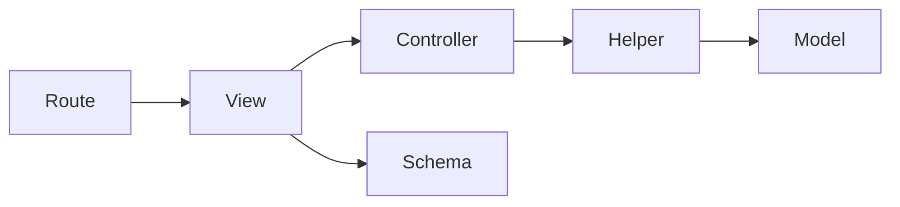

# Architecture

## Request boundary

| Layer | Owns | Must not own |
|---|---|---|
| Route | HTTP path, method, dependencies, status | Database queries |
| View | Request/response adaptation | Persistence rules |
| Controller | Use case and transaction | HTTP response objects |
| Helper | Focused database/integration I/O | Hidden commits |
| Model/schema | Persistence and validated contracts | Use-case orchestration |

The example task module lives in `src/fastapi_starter/apps/tasks`. It is intentionally
small enough to copy as a pattern and complete enough to demonstrate every layer.

## Runtime

The API is stateless and horizontally scalable. PostgreSQL owns durable state.
Configuration comes from environment variables. Liveness proves the process can
answer; readiness proves its database dependency can answer. Neither endpoint
claims an end-to-end product flow succeeded.

Each request receives a bounded, safe request ID. Logs are JSON. HTTP metrics use
route templates rather than raw URLs to prevent unbounded label cardinality.

## Production extension points

Add capabilities only when a real requirement needs them:

- Authentication before exposing user-owned resources
- Redis only for rebuildable cache or bounded coordination
- A queue only for work that must outlive the request or absorb bursts
- OpenTelemetry when cross-service trace correlation becomes actionable
- Rate limiting at the edge when abuse or capacity data justifies a policy

The boilerplate does not include these by default because unused infrastructure
slows delivery and creates operational responsibility without product value.
